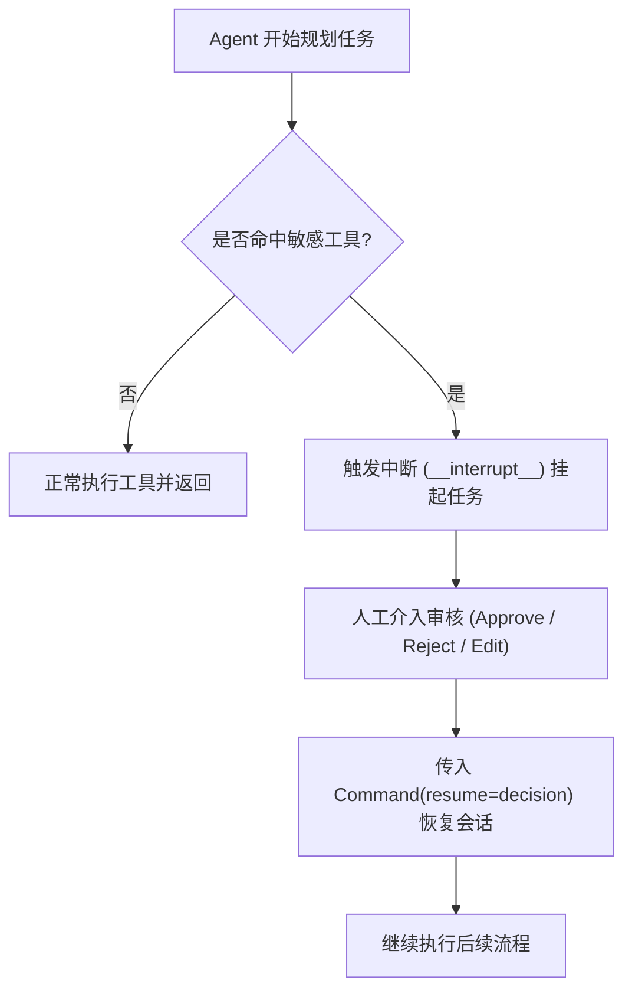

# Day 01: DeepAgents 基本概念与基础能力

---

## 1. 智能体发展历程

### 1.1 发展过程演进

| 阶段 | 架构模式 | 核心特点与能力 | 存在的问题 / 瓶颈 |
| :--- | :--- | :--- | :--- |
| **时代 1** | **非智能体 (传统调用)** | 传统业务系统封装，仅单次调用大模型 API 完成局部功能。 | 无法自主规划，无工具编排能力。 |
| **时代 2** | **单智能体 (LangChain / OpenAI Agent)** | 具备模型、工具集、记忆机制与规划能力，能够自主将任务拆解为子目标。 | **上下文膨胀与注意力下降**：单一上下文与模型难以兼顾多场景，长链任务易出现记忆混淆。 |
| **时代 3** | **深度代理多智能体 (DeepAgents)** | 构建**智能体集群**：<br>1. **主智能体**：负责全局规划、任务拆解与路由分发，不处理具体业务。<br>2. **子智能体**：专精垂直业务，拥有独立的模型与隔离的上下文空间。 | **Token 消耗偏高**，且多层协同存在黑盒调试门槛。 |

### 1.2 实现多智能体的必备技术栈

1. **深度代理框架 (DeepAgents)**：负责多智能体集群的管理、调度与动态拓扑控制。
2. **高阶提示词 (Meta-Prompting)**：在多智能体架构中，主代理提示词遵循“**指导不包办**”原则，聚焦角色定义、决策边界与任务协议，避免过度规定执行细节。

---

## 2. DeepAgents 框架入门

### 2.1 LangChain 家族框架定位与对比

- **LangChain (Framework)**：基础层，负责与各类大模型进行原子化交互及通用组件接入。
- **LangGraph (Runtime)**：运行控制层，专长于**确定性/固化流程控制**，支持状态机管理与少量条件分支。
- **DeepAgents (Harness)**：架构治理层，专注于**高复杂度开放任务、子代理动态规划及生命周期管控**。

### 2.2 架构参考
- [LangChain Concepts & Products](https://docs.langchain.com/oss/python/concepts/products)

### 2.3 快速入门案例流程

#### 步骤 1：安装依赖
```bash
pip install deepagents tavily-python python-dotenv langchain-openai
# 或使用 uv：
uv add deepagents tavily-python python-dotenv langchain-openai
```

#### 步骤 2：初始化与加载配置
```python
import os
from dotenv import load_dotenv

load_dotenv(override=True)
```

#### 步骤 3：初始化模型对象
```python
from langchain.chat_models import init_chat_model

model = init_chat_model(
    model=os.getenv("LLM_MODEL", "deepseek-flash"),
    model_provider="openai"
)
```

#### 步骤 4：定义联网搜索工具
> [!TIP]
> 工具定义需同时配置完整的函数 Docstring 与描述，大模型依靠这些描述决定何时何地调用该工具。

```python
from langchain_core.tools import tool
from tavily import TavilyClient

tavily_client = TavilyClient(api_key=os.getenv("TAVILY_API_KEY"))

@tool
def search_web(query: str, max_results: int = 10):
    """用于联网搜索实时信息与公开数据的工具。"""
    return tavily_client.search(query, max_results=max_results)
```

#### 步骤 5：构建 DeepAgent
```python
from deepagents import create_deep_agent

deep_agent = create_deep_agent(
    model=model,
    tools=[search_web],
    system_prompt="你是一个专业的信息检索与调研管家。明确角色职责、推理能力与输出边界。"
)
```

#### 步骤 6：任务执行与结果获取
```python
from langchain_core.messages import HumanMessage

# 执行调用
result = deep_agent.invoke(
    input={"messages": [HumanMessage(content="查询北京今天的天气状况")]}
)

# 解析最终结果 (State 为 LangGraph 规范的 TypedDict)
print(result["messages"][-1].content)
```

---

### 2.4 核心执行机制与使用总结

#### 1. 执行函数对比
- **`invoke` / `ainvoke`**：一次性运行完整流程并返回最终聚合结果，适合批处理或非实时场景。
- **`stream` / `astream`**（**推荐**）：流式返回每个节点的事件更新与状态快照，适合展示推理过程与中间工具调用。

#### 2. 参数传递规范
无论是 `invoke` 还是 `stream`，统一接收字典结构：
```python
input = {"messages": [HumanMessage(content="...")]}  # 或使用字典格式: {"role": "user", "content": "..."}
```

#### 3. 结果解析与 Stream 场景分流

##### (1) `invoke` / `ainvoke` 的消息链结构
返回内容包含完整的执行过程，按时序在 `messages` 列表中累加：
```text
messages: [
  HumanMessage(content="用户输入"),
  AIMessage(content="", tool_calls=[{"name": "...", "args": {...}}]),
  ToolMessage(content="工具执行结果"),
  ...
  AIMessage(content="最终回复结果", tool_calls=[])
]
```

##### (2) `stream` / `astream` 的 5 种核心分流场景
流式遍历返回的 `chunk` 格式为 `{node_name: {"messages": [...]}}`：
1. **模型决定调用普通工具**：`node_name == 'model'` 且 `tool_call['name'] != 'task'`
2. **模型决定调度子智能体**：`node_name == 'model'` 且 `tool_call['name'] == 'task'`
3. **模型最终回复**：`node_name == 'model'` 且存在 `message.content`，无 `tool_calls`
4. **普通工具执行完毕返回**：`node_name == 'tools'` 且 `message.name != 'task'`
5. **子智能体执行完毕返回**：`node_name == 'tools'` 且 `message.name == 'task'`

##### (3) 标准分流解析模板
```python
for chunk in deep_agent.stream({"messages": [{"role": "user", "content": query}]}):
    for node_name, state in chunk.items():
        if (not state) or ("messages" not in state):
            continue
        message = state["messages"][-1]

        # 1. 模型决策与回复节点
        if node_name == "model":
            if message.content:
                print(f"[模型最终结果]: {message.content[:100]}...")
            else:
                for tool_call in message.tool_calls:
                    if tool_call["name"] == "task":
                        subagent = tool_call["args"].get("subagent_type")
                        print(f"[主代理决策] 调度子智能体 [{subagent}] 处理子任务")
                    else:
                        print(f"[主代理决策] 调用工具 [{tool_call['name']}], 参数: {tool_call['args']}")

        # 2. 工具与子代理执行节点
        elif node_name == "tools":
            if message.name == "task":
                print(f"[子智能体执行完成] 返回内容截断: {message.content[:100]}...")
            else:
                print(f"[工具 {message.name} 执行完成] 返回内容: {message.content[:100]}...")
```

---

## 3. DeepAgents 子代理（Subagents）配置

### 3.1 多智能体核心思想与弊端
- **核心思想**：分而治之。主智能体专注调度，子智能体深耕垂直领域。
- **主要代价**：网络通信与 Token 消耗加剧，链路复杂导致排障与可观测性成本上升。

### 3.2 启用多智能体的四大铁律
在决定是否采用多智能体架构前，必须满足以下一条或多条特征：
1. **问题极度开放**：输入意图具有高度不确定性，无法用固化流程或状态机（LangGraph）穷尽。
2. **存在领域性冲突**：各子任务横跨不同垂直专业（如金融风控、法律合规、技术测试），单提示词容易发生上下文混淆。
3. **存在并发性能诉求**：子任务之间彼此独立，能够并行派发给多个子智能体以降低整体延迟。
4. **存在异构模型诉求**：不同任务依赖不同模型特性（如大语言模型、轻量模型、Embedding 检索、视觉多模态模型）。

### 3.3 拓扑协作模式对比
- **层级工作流 (Hierarchical)**（DeepAgents 采用）：主代理充当大脑进行拆解分发与综合汇总，职责清晰、可控度高。
- **网状协作工作流 (Decentralized / Swarm)**：智能体扁平平级互传，无全局大脑，开放任务下容易产生无效震荡与循环死锁。

---

### 3.4 子代理创建方式

#### 方式一：基于字典创建（推荐）
字典包含五个固定元字段：
- `name`：子代理唯一标识，用于主代理调度时的名称索引。
- `description`：功能描述，注入主代理的 System Prompt，是主代理决策调度的关键依据。
- `system_prompt`：子代理自身与模型交互时的专属提示词（明确角色、业务流程、边界格式）。
- `tools`：子代理专属的工具函数列表。
- `model`：子代理指定的特定模型实例（缺省时自动复用主代理的模型）。

##### 完整演示代码
```python
import os
from dotenv import find_dotenv, load_dotenv
from langchain.chat_models import init_chat_model
from deepagents import create_deep_agent

load_dotenv(find_dotenv())

# 1. 初始化模型
llm = init_chat_model(
    model=os.getenv("LLM_MODEL", "deepseek-flash"),
    temperature=0.1,
    model_provider="openai"
)

# 2. 定义天气助手子代理
weather_agent = {
    "name": "weather_helper",
    "description": "用于查询城市天气信息的专业助手。",
    "system_prompt": "你是一个天气助手。无论用户询问哪个城市的天气，统一回复：'今日天气晴朗，气温 25 度，适合出游。'",
    "tools": []
}

# 3. 定义数学计算子代理
math_agent = {
    "name": "math_helper",
    "description": "用于处理复杂数学计算、逻辑运算问题的助手。",
    "system_prompt": "你是一个严谨的数学专家，专注为用户进行数学题求解和精密计算。",
    "tools": []
}

# 4. 定义翻译助手子代理
translate_agent = {
    "name": "translator",
    "description": "用于中英文互译任务的语言专家。",
    "system_prompt": "你是一个翻译助手。输入中文则翻译为英文，输入英文则翻译为中文，保持信达雅。",
    "tools": []
}

# 5. 注册主智能体
main_agent = create_deep_agent(
    model=llm,
    tools=[],  # 主代理无需基础工具，依靠子代理集群协同
    subagents=[weather_agent, math_agent, translate_agent],
    system_prompt="你是一个全能调度管家。根据用户诉求合理拆解任务并分配给对应的专业助手。"
)

# 6. 流式测试运行
def test_stream(query: str):
    print(f"\n>>> 用户提问: {query}")
    for chunk in main_agent.stream({"messages": [{"role": "user", "content": query}]}):
        for node_name, state in chunk.items():
            if not state or "messages" not in state:
                continue
            last_msg = state["messages"][-1]
            if node_name == "model":
                if last_msg.tool_calls:
                    for tc in last_msg.tool_calls:
                        if tc["name"] == "task":
                            print(f"[调度决策] 激活子智能体: {tc['args'].get('subagent_type')}")
                        else:
                            print(f"[调度决策] 执行工具: {tc['name']}")
                elif last_msg.content:
                    print(f"[最终结论] {last_msg.content}")
            elif node_name == "tools":
                preview = (last_msg.content[:80] + "...") if len(last_msg.content) > 80 else last_msg.content
                print(f"[执行回传] {preview}")

if __name__ == "__main__":
    test_stream("北京今天天气怎么样？")
    test_stream("100 + 256 等于多少？")
```

---

#### 方式二：基于 `CompiledSubAgent` 封装

##### 1. 存在背景与使用场景
用于将已有 LangGraph 状态图编译对象（`compile()` 产物）或 LangChain 的 `create_agent` 原生包装为 DeepAgents 的子节点。
- **适用场景**：主任务高度开放（由 DeepAgent 规划），但某个子环节的内部执行流高度固化（必须按 1 -> 2 -> 3 刚性顺序流转）。

##### 2. 融合模式的架构权衡
- **代码级融合（CompiledSubAgent）**：
  > [!WARNING]
  > 强耦合！外部状态与内部 State 强绑定（要求 State 严格遵循 `messages: Annotated[list, add_messages]` 协议），代码不易剥离复用。
- **服务化/函数级融合（推荐的最佳实践）**：
  - **API 接口形式**：通过 FastAPI 将 RAG 系统或业务系统暴露为 HTTP 接口。
  - **SDK / Tool 形式**：将固化流程封装为普通的 `@tool` 函数供智能体调用，实现清晰的解耦隔离。

##### 3. 示例：包装 LangChain `create_agent`
```python
from deepagents import CompiledSubAgent

langchain_subagent = CompiledSubAgent(
    name="langchain_subagent",
    description="负责进行算术运算的子智能体，有数学计算需求时调度此智能体。",
    runnable=langchain_agent  # 已经构建好的 LangChain agent 实例
)
```

##### 4. 示例：包装 LangGraph 编译图
- **核心前提**：
  1. 状态必须包含 `messages: list` 并且支持追加语义。
  2. 节点必须返回字典 `{"messages": [AIMessage(...)]}`。
```python
from typing import TypedDict, Annotated
from langgraph.graph.message import add_messages
from langchain_core.messages import AIMessage
from deepagents import CompiledSubAgent

class SubState(TypedDict):
    messages: Annotated[list, add_messages]

def calculate_node(state: SubState):
    user_query = state["messages"][-1].content
    # 模拟计算逻辑
    return {"messages": [AIMessage(content=f"计算处理结果: {user_query}")]}

# 构建并编译图
from langgraph.graph import StateGraph
builder = StateGraph(SubState)
builder.add_node("calc", calculate_node)
builder.set_entry_point("calc")
graph = builder.compile()

# 包装为子代理
compiled_agent = CompiledSubAgent(
    name="custom_graph_agent",
    description="专业执行定制图流转计算的子智能体。",
    runnable=graph
)
```

---

## 4. 阶段总结与关键记忆点

1. **发展演进**：直接 API 交互 $\rightarrow$ 单 Agent (工具+记忆) $\rightarrow$ DeepAgents Harness (多代理集群 + 动态调度)。
2. **框架分工**：
   - `LangChain`：原子组件框架 (Framework)
   - `LangGraph`：状态图与固化流运行态 (Runtime)
   - `DeepAgents`：多智能体治理治理底座 (Harness)
3. **调用机制**：
   - `stream` 模式下重点监控 `model` 节点的 `tool_calls` 与 `tools` 节点的 `task` 判定。
4. **子代理模式选型**：
   - 优先采用 **字典定义法 (`dict`)**，轻量且低耦合。
   - 复杂的子业务流程优先通过 **FastAPI 接口或 Tool SDK** 接入，尽量避免过重的 `CompiledSubAgent` 代码绑定。

---

## 5. HITL (Human-in-the-Loop) 人机协同

### 5.1 概念与核心价值
在执行敏感操作（如删除文件、修改数据库、发起支付结算、发送公文邮件）时，暂停 Agent 的自动化流转，引入**人工干预机制**，提供三大审计选项：
- **`approve` (同意)**：直接放行执行。
- **`edit` (编辑)**：修改工具调用的入参后再行执行。
- **`reject` (拒绝)**：拒绝执行该操作，并将拒绝信息反馈给模型让其重新规划。

---

### 5.2 最佳实践标准流程



#### 步骤 1：开启工具拦截配置 (`interrupt_on`)
```python
create_deep_agent(
    model=model,
    tools=tools,
    subagents=subagents,
    interrupt_on={
        "delete_database": True,  # 允许 approve / edit / reject
        "send_salary": {"allowed_decisions": ["approve", "reject"]}  # 仅允许批准或拒绝
    }
)
```

#### 步骤 2：配置短期记忆检查点 (`checkpointer`)
> [!IMPORTANT]
> 触发中断后必须能够持久化状态。恢复执行时，Agent 依据相同的 `thread_id` 从检查点接续上下文继续推演。

```python
from langgraph.checkpoint.memory import InMemorySaver

checkpointer = InMemorySaver()

deep_agent = create_deep_agent(
    model=model,
    tools=tools,
    interrupt_on={"delete_file": True},
    checkpointer=checkpointer
)
```

#### 步骤 3：固定线程标识 (`thread_id`) 发起调用
```python
config = {"configurable": {"thread_id": "session_001"}}

# 初次触发执行
result = deep_agent.invoke(
    input={"messages": [{"role": "user", "content": "请帮我清理并删除系统日志文件"}]},
    config=config
)
```

#### 步骤 4：拦截判定与恢复决策 (`Command(resume=...)`)
```python
from langgraph.types import Command

# 1. 检查是否存在中断
if "__interrupt__" in result:
    interrupt_info = result["__interrupt__"][0].value
    action_requests = interrupt_info.get("action_requests", [])
    print(f"检测到待人工审批的工具调用: {action_requests}")

    # 2. 构造放行决策 (approve 示例)
    decisions = [{"type": "approve"} for _ in action_requests]

    # 3. 恢复会话执行
    resumed_result = deep_agent.invoke(
        Command(resume={"decisions": decisions}),
        config=config
    )
```

---

### 5.3 审批与拒绝（Approve / Reject）实现机制
```python
# 批准放行
decisions = [{"type": "approve"}]

# 拒绝执行并携带反馈
decisions = [{"type": "reject", "message": "管理员拒绝了删除文件的请求，请改用归档备份方案"}]

# 恢复执行
final_result = deep_agent.invoke(
    Command(resume={"decisions": decisions}),
    config=config
)
```

---

### 5.4 动态编辑（Edit）实现机制与参数结构
当人工需要修正大模型给出的工具入参时，可返回 `edit` 类型的动作定义：
```python
edit_decision = {
    "type": "edit",
    "edited_action": {
        "name": "delete_file",
        "args": {
            "path": "/data/backup/temp.log",  # 将风险根目录修改为安全的临时目录
            "force": False
        }
    }
}

result = deep_agent.invoke(
    Command(resume={"decisions": [edit_decision]}),
    config=config
)
```

---

### 5.5 Stream 模式下的 HITL 拦截捕获
在流式调用中，直接监听 `__interrupt__` 事件流：
```python
for chunk in deep_agent.stream(input_data, config=config):
    if "__interrupt__" in chunk:
        print("[HITL 中断通知] 系统已被挂起，等待人工审核决策...")
        break
```
